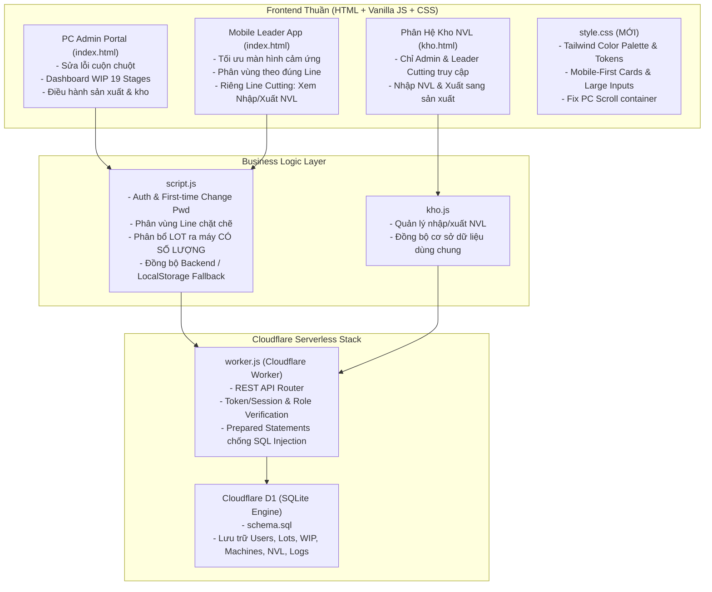

# KẾ HOẠCH TRIỂN KHAI APP ERP SẢN XUẤT EMS - BIC (7 LINES & 19 STAGES)

Tài liệu thiết kế chi tiết và kế hoạch triển khai nâng cấp hệ thống ERP quản lý sản xuất xưởng cơ khí/điện tử BIC, tích hợp phân quyền di động cho Leader, hoàn thiện giao diện PC cho Admin, sửa lỗi đăng nhập/đổi mật khẩu, bổ sung phân bổ số lượng LOT ra máy, và xây dựng Backend Cloudflare Worker + SQLite (Cloudflare D1).

---

## 1. Mục Tiêu Dự Án & Bối Cảnh (Goal Description)

Hệ thống hiện tại có 4 file cốt lõi:
- [index.html](file:///d:/My%20app_web/m-erp/index.html): Màn hình đăng nhập, Admin Portal văn phòng, và Leader di động.
- [script.js](file:///d:/My%20app_web/m-erp/script.js): Nghiệp vụ sản xuất 7 Lines, 19 Stages, sơ đồ máy móc, chẻ LOT, xử lý NG, chuyển giao PASS/NG.
- [kho.html](file:///d:/My%20app_web/m-erp/kho.html): Phân hệ Quản lý Kho NVL (nhập kho, cấp phát NVL xuống LOT/máy, tồn kho tức thời, nhà cung cấp).
- [kho.js](file:///d:/My%20app_web/m-erp/kho.js): Logic nghiệp vụ kho NVL, kiểm soát truy cập (chỉ Admin và Leader Cutting).

### Các Vấn Đề Cần Giải Quyết:
1. **Thiếu file `style.css`**: Cả `index.html` và `kho.html` đều đang nhúng `style.css` nhưng file chưa hề tồn tại trong thư mục dự án!
2. **Lỗi lăn chuột (mouse wheel scroll) trên PC cho Admin**: Admin dùng chuột lăn không cuộn được bảng và nội dung khi màn hình dài.
3. **Trải nghiệm di động cho Leader**: Các Leader đứng dưới xưởng dùng điện thoại (màn hình nhỏ) cần giao diện cảm ứng lớn, tab tiện lợi, thẻ WIP & máy móc tối ưu dọc.
4. **Phân quyền nghiêm ngặt xưởng sản xuất**:
   - Leader của Line nào thì **chỉ xem và thao tác trên công đoạn và máy của Line mình** (ví dụ: Leader Line NC chỉ thấy NC1, NC2, NC3).
   - Riêng **Leader Line CUTTING** được quyền đặc biệt: Xem và thao tác **Nhập NVL** và **Xuất NVL qua khâu sản xuất**.
   - Chặn quyền đổi chéo tài khoản của Leader (bỏ dropdown tự do đổi Leader khi đang đăng nhập thực tế).
5. **Sửa lỗi đăng nhập & Đổi mật khẩu lần đầu**:
   - Hiện tại hàm submit không kiểm tra mật khẩu.
   - Bổ sung xác thực mật khẩu, cờ `must_change_password` (bắt buộc đổi mật khẩu khi đăng nhập lần đầu tiên).
   - Modal/form đổi mật khẩu mới trực quan, lưu an toàn.
6. **Bổ sung Số Lượng Phân Bổ khi gán LOT ra Máy**:
   - Hiện tại gán LOT vào máy chỉ có chọn máy mà **chưa cho nhập số lượng phân bổ** (ví dụ: LOT 300 cái, muốn phân 100 cái vào Máy 1, 200 cái vào Máy 2 hoặc phân cụ thể số lượng bao nhiêu).
7. **Bảo toàn kiến trúc Frontend & Xây dựng Backend Cloudflare Worker + SQLite**:
   - Giữ nguyên cấu trúc thuần: HTML, Vanilla JavaScript, CSS (không cần build tool phức tạp, chạy trực tiếp trên browser hoặc Cloudflare Pages).
   - Tạo file `schema.sql` (chuẩn SQLite / Cloudflare D1) mô hình hóa đầy đủ 7 Lines, 19 Stages, Users, Lots, Machines, Materials, Logs.
   - Tạo file `worker.js` (Cloudflare Worker REST API) xử lý đầy đủ nghiệp vụ CRUD, phân quyền, đăng nhập, đổi pass, gán máy, chuyển công đoạn.
   - Tạo file tài liệu Markdown hướng dẫn triển khai (`HUONG_DAN_TRIEN_KHAI.md`) dễ hiểu, chi tiết từng bước.

---

## 2. Kiến Trúc Hệ Thống (System Architecture)

---

## 3. Các Thay Đổi Cụ Thể (Proposed Changes)

### Component 1: Giao Diện & Trải Nghiệm Người Dùng (CSS & PC Scroll Fix)
#### [NEW] [style.css](file:///d:/My%20app_web/m-erp/style.css)
- **Thiết kế hệ màu chuyên nghiệp (Tailwind-inspired)**:
  - `--navy: #0f172a`, `--slate: #1e293b`, `--border: #cbd5e1`, `--bg: #f8fafc`.
  - Phân màu 7 Lines rõ ràng: CUTTING (`#fee2e2`), NC (`#e0f2fe`), MNC (`#dcfce7`), GS_GV (`#ffedd5`), GP_GE_GI (`#f3e8ff`), ASSY (`#fef9c3`), KENSA (`#f1f5f9`).
- **Sửa triệt để lỗi cuộn chuột trên PC cho Admin**:
  - Loại bỏ các thiết lập khóa tràn `overflow: hidden` ở cấp độ `body` hoặc `html` không mong muốn.
  - Thiết lập `.app-body`: `display: flex; min-height: calc(100vh - 56px); height: calc(100vh - 56px); overflow: hidden;`.
  - Thiết lập `.content`: `flex: 1; overflow-y: auto; overflow-x: hidden; height: 100%; -webkit-overflow-scrolling: touch; padding: 16px;`.
  - Thiết lập `.table-wrap`: `overflow-x: auto; overflow-y: visible; max-width: 100%;` giúp cuộn chuột dọc trang PC mượt mà mà vẫn cuộn ngang bảng ma trận được.
- **Tối ưu hóa di động cho Leader**:
  - Giao diện dạng card dọc, khoảng cách chạm tối thiểu 44px (touch-friendly targets).
  - Thanh tab di động dạng sticky phía trên hoặc dưới màn hình.
  - Các ô nhập số lượng lớn (`.big-input`), bàn phím số thích ứng trên điện thoại (`inputmode="numeric"`).
  - Badge trạng thái máy (Đang chạy / Rảnh) to, rõ nét với màu tương phản cao.

---

### Component 2: Màn Hình & Tương Tác Frontend
#### [MODIFY] [index.html](file:///d:/My%20app_web/m-erp/index.html)
- **Thêm Modal / Màn hình Đổi Mật Khẩu Lần Đầu**:
  - Khi Leader đăng nhập với cờ `must_change_pwd = true`, hiển thị modal bắt buộc nhập mật khẩu mới và xác nhận mật khẩu trước khi vào ứng dụng.
- **Tối ưu Màn Hình Leader Di Động**:
  - Thêm ô nhập **"Số lượng phân bổ cho máy"** trực tiếp trên từng thẻ LOT chờ.
  - Đối với **Leader Line CUTTING**: Bổ sung tab/card con **"Nhập / Xuất NVL Sản Xuất"** ngay trên giao diện Leader để xem nhanh phôi nhập về và phôi xuất ra máy cắt mà không cần phải bấm chuyển trang liên tục.
  - Khóa ô chọn chuyển quyền `quick-switch-leader`: Ẩn đối với Leader thông thường để đảm bảo Leader Line nào chỉ thấy Line mình; chỉ bật thanh chuyển nhanh nếu tài khoản là ADMIN hoặc chế độ Demo.
- **Cải tiến thông báo Toast & Trực quan hóa**:
  - Nút bấm to, dễ thao tác bằng ngón tay cái trên điện thoại.

#### [MODIFY] [script.js](file:///d:/My%20app_web/m-erp/script.js)
- **Nâng cấp Hệ Thống Tài Khoản & Mật Khẩu**:
  - Khởi tạo danh mục tài khoản mặc định có mật khẩu (mặc định ban đầu: `123`) và cờ `must_change_pwd: true`.
  - Bổ sung hàm `changePassword(oldPass, newPass)` cập nhật mật khẩu vào kho lưu trữ.
- **Phân Vùng Line Nghiêm Ngặt**:
  - Khi Leader đăng nhập: Lọc tuyệt đối chỉ lấy danh sách `stages` và `machines` có `line_id === currentUser.line_id`.
  - Ẩn toàn bộ công đoạn ngoài line khỏi bộ lọc và màn hình của Leader.
  - Leader Line CUTTING: Thêm quyền xem sổ giao dịch NVL (`db.nvlLogs`) ngay tại giao diện di động.
- **Phân Bổ LOT Ra Máy Kèm Số Lượng (Allocation Quantity)**:
  - Cập nhật hàm `assignLotToStageMachine(soLot, stageCode, maMay, soLuongPhanBo)`:
    - Kiểm tra số lượng phân bổ `<= waiting` hiện tại của LOT tại công đoạn đó.
    - Lưu thông tin số lượng được gán cho máy.
    - Hỗ trợ phân bổ một phần (Partial allocation) hoặc toàn phần nếu LOT có số lượng lớn cần chạy trên nhiều máy.
- **Tích Hợp API Cloudflare Worker**:
  - Bổ sung tầng `ApiClient` kết nối trực tiếp với Cloudflare Worker (`/api/...`).
  - Nếu không có mạng hoặc đang chạy offline/file tĩnh, hệ thống tự động fallback về `localStorage` đảm bảo app chạy mượt mà mọi lúc.

#### [MODIFY] [kho.html](file:///d:/My%20app_web/m-erp/kho.html) & [kho.js](file:///d:/My%20app_web/m-erp/kho.js)
- Đồng bộ giao diện với `style.css` mới.
- Kiểm tra phân quyền: Chỉ cho phép ADMIN và Leader Line CUTTING được vào kho.

---

### Component 3: Cơ Sở Dữ Liệu SQLite & Backend Cloudflare Worker
#### [NEW] `schema.sql`
Thiết kế chuẩn SQLite (Cloudflare D1) gồm 11 bảng quan hệ chặt chẽ:
1. `users`: Tài khoản, mật khẩu (băm SHA-256), họ tên, vai trò (ADMIN / LEADER), `line_id`, cờ `must_change_pwd`.
2. `lines`: Danh mục 7 Lines (`CUTTING`, `NC`, `MNC`, `GS_GV`, `GP_GE_GI`, `ASSY`, `KENSA`).
3. `stages`: Danh mục 19 Công đoạn, liên kết `line_id`, thứ tự quy trình.
4. `machines`: Danh mục máy móc, công đoạn phụ trách, công suất ca, trạng thái (`RUNNING`, `IDLE`, `MAINTENANCE`), LOT và số lượng đang chạy.
5. `products`: Mã hàng (`ma_sp`), tên sản phẩm, quy cách, lộ trình Routing JSON.
6. `lots`: Danh sách LOT sản xuất, PO gốc, ngày cấp, tổng số lượng, hoàn thành nhập kho TP.
7. `lot_wip`: Tiến độ chi tiết từng LOT qua từng Stage (`waiting`, `good`, `ng`, `assigned_machine`, `assigned_qty`).
8. `suppliers`: Nhà cung cấp nguyên vật liệu.
9. `materials`: Danh mục NVL, nhóm, quy cách, ĐVT, tổng nhập, tổng xuất SX, tồn kho tức thời.
10. `production_logs`: Lịch sử giao dịch từng ca (người làm, máy, LOT, từ stage -> đến stage, PASS, NG, thời gian).
11. `material_logs`: Sổ cái nhập kho NVL và xuất NVL phân bổ xuống từng máy/LOT.

#### [NEW] `worker.js`
Cloudflare Worker (ES Module) xử lý REST API:
- `POST /api/auth/login`: Xác thực tài khoản, kiểm tra mật khẩu, trả về thông tin user & trạng thái đổi mật khẩu.
- `POST /api/auth/change-password`: Cập nhật mật khẩu mới và gỡ cờ `must_change_pwd`.
- `GET /api/bootstrap`: Tải toàn bộ dữ liệu khởi tạo (Lines, Stages, Machines, Lots, Materials, Logs).
- `POST /api/production/assign-machine`: Gán LOT vào máy kèm số lượng phân bổ.
- `POST /api/production/move`: Giao nhận PASS/NG giữa các công đoạn.
- `POST /api/production/split-lot`: Chẻ LOT từ PO gốc.
- `POST /api/kho/transaction`: Ghi nhận phiếu Nhập kho NVL hoặc Xuất NVL sản xuất.
- `OPTIONS *`: Xử lý CORS hoàn chỉnh, cho phép gọi từ bất kỳ domain hoặc file local nào.

#### [NEW] `wrangler.jsonc` (hoặc `wrangler.toml`)
Cấu hình chuẩn của Cloudflare Worker kết nối cơ sở dữ liệu Cloudflare D1 Database.

#### [NEW] `HUONG_DAN_TRIEN_KHAI.md`
Tài liệu hướng dẫn bằng tiếng Việt cực kỳ chi tiết:
- Hướng dẫn chạy thử Frontend ngay trên máy tính mà không cần cài đặt gì.
- Hướng dẫn cài đặt Wrangler, tạo Database D1 trên Cloudflare (`wrangler d1 create bic-erp-db`).
- Hướng dẫn chạy file `schema.sql` để khởi tạo bảng và dữ liệu mẫu.
- Hướng dẫn Deploy Worker lên Cloudflare (`npx wrangler deploy`).
- Hướng dẫn kết nối Frontend với URL Worker của Cloudflare.

---

## 4. Kế Hoạch Xác Minh & Kiểm Thử (Verification Plan)

### Kiểm Thử Tự Động & Cú Pháp:
- Kiểm tra tính hợp lệ cú pháp của `schema.sql` thông qua SQLite CLI hoặc node-sqlite.
- Kiểm tra cú pháp của `worker.js` bằng cú pháp ES Module chuẩn.
- Kiểm tra không còn lỗi tham chiếu CSS bị thiếu trên `index.html` và `kho.html`.

### Kiểm Thử Thủ Công (Manual Verification):
1. **Kiểm tra Lăn Chuột trên PC (Admin Portal)**:
   - Đăng nhập quyền `ADMIN`.
   - Vào tab "Bảng TK (WIP 19 Stages)", tab "Sơ Đồ Máy", tab "Quản Lý Mã Hàng".
   - Dùng con lăn chuột cuộn lên/xuống toàn màn hình: Nội dung phải cuộn mượt mà, không bị giật, không bị cắt nội dung.
2. **Kiểm tra Giao Diện Mobile & Phân Quyền Leader**:
   - Thu nhỏ trình duyệt về kích thước di động (375px - 414px) hoặc mở F12 chế độ Mobile.
   - Đăng nhập `LD_NC`:
     - Kiểm tra màn hình chỉ hiển thị các công đoạn: `NC1`, `NC2`, `NC3` và máy thuộc Line NC.
     - Kiểm tra KHÔNG nhìn thấy nút mở Kho NVL (`kho.html`).
   - Đăng nhập `LD_CUTTING`:
     - Kiểm tra hiển thị công đoạn `CAT`, `NHIET_LUYEN`, `DO_CUNG`.
     - Kiểm tra hiển thị nút và mục **Xem Nhập / Xuất NVL Sản Xuất**.
     - Bấm sang `kho.html` truy cập bình thường.
3. **Kiểm tra Đổi Mật Khẩu Lần Đầu**:
   - Đăng nhập với tài khoản chưa đổi mật khẩu (ví dụ `LD_ASSY` / `123`).
   - Hệ thống phát hiện lần đầu đăng nhập -> bật Modal đổi mật khẩu.
   - Nhập mật khẩu mới -> xác nhận đổi thành công -> đăng xuất và đăng nhập lại bằng mật khẩu mới.
4. **Kiểm tra Phân Bổ LOT Ra Máy Kèm Số Lượng**:
   - Chọn 1 LOT đang chờ (ví dụ LOT có 300 cái).
   - Nhập số lượng phân bổ: 150 cái -> chọn Máy 1 -> Bấm phân máy.
   - Kiểm tra máy hiển thị đúng số lượng 150 cái được gán.
5. **Kiểm tra Backend Cloudflare Worker & D1**:
   - Chạy lệnh test thử worker hoặc kiểm tra endpoint `/api/bootstrap` trả về JSON dữ liệu chuẩn.
